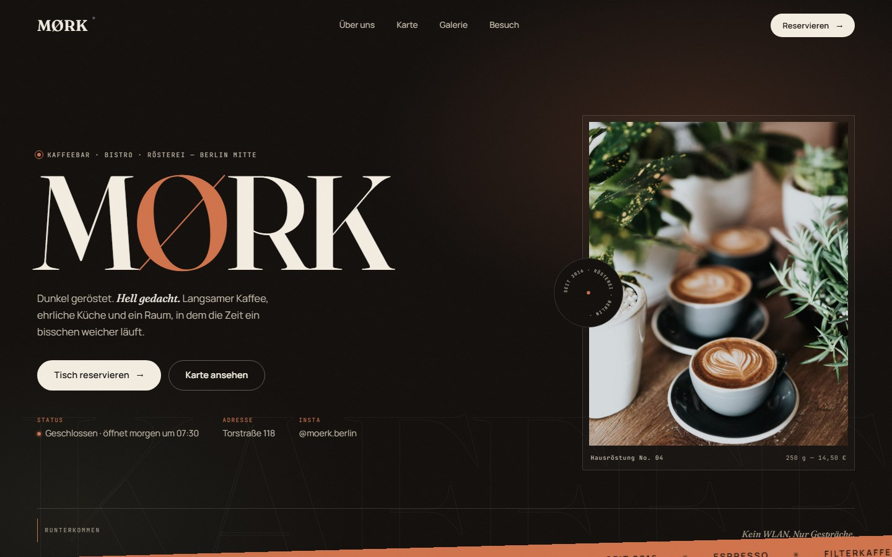

# MØRK — Kaffeebar, Bistro & Rösterei

Ein dunkler, editorial gestalteter Onepager für ein fiktives Café in Berlin-Mitte. Kein Build, kein Framework – nur HTML, CSS und Vanilla JavaScript.

## Features

- Hero mit Preloader, rotierendem Badge, Parallax und gestaffelter Einblendung
- Live-Status „Jetzt geöffnet / Geschlossen“ nach Berliner Zeit
- Laufband, Scroll-Reveals, Scroll-Fortschrittsbalken und Custom Cursor
- Speisekarte mit Tabs für Kaffee, Küche und Naturwein
- Bild-Vorschau beim Hovern über Gerichte (Desktop)
- Galerie mit barrierearmer Lightbox (Tastatursteuerung inklusive)
- Reservierungsformular mit Validierung und Erfolgsmeldung
- Vollbild-Mobile-Navigation und responsives Layout
- Strukturierte Daten (JSON-LD), Open-Graph-Meta und Skip-Link
- Lighthouse: 100 für Accessibility, SEO und Best Practices

## Dateien

| Datei | Inhalt |
| --- | --- |
| `index.html` | Inhalte und Semantik |
| `styles.css` | Design, Layout und Animationen |
| `script.js` | Interaktionen, Status, Lightbox und Formular |

## Lokal ansehen

Einfach `index.html` im Browser öffnen – es ist kein Server und kein Build nötig.

## Anpassen

- **Texte, Preise, Öffnungszeiten:** in `index.html`
- **Farben, Schriften, Abstände:** über die CSS-Variablen oben in `styles.css`
- **Interaktionen:** in `script.js`

Die Inhalte (Adresse, Telefonnummer, E-Mail, Speisekarte) sind Demo-Daten. Bilder stammen von Unsplash, die Schriften von Google Fonts – beides benötigt eine Internetverbindung.

## Auf GitHub Pages veröffentlichen

1. Repository-Einstellungen → **Pages**
2. Unter **Build and deployment** die Option **Deploy from a branch** wählen
3. Branch `main` und Ordner `/ (root)` auswählen
4. Speichern – die Seite ist anschließend unter `https://<username>.github.io/<repo>/` erreichbar
